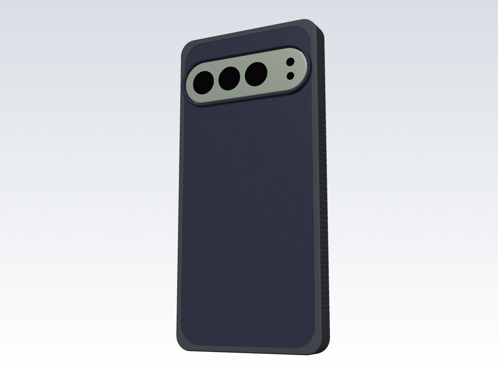
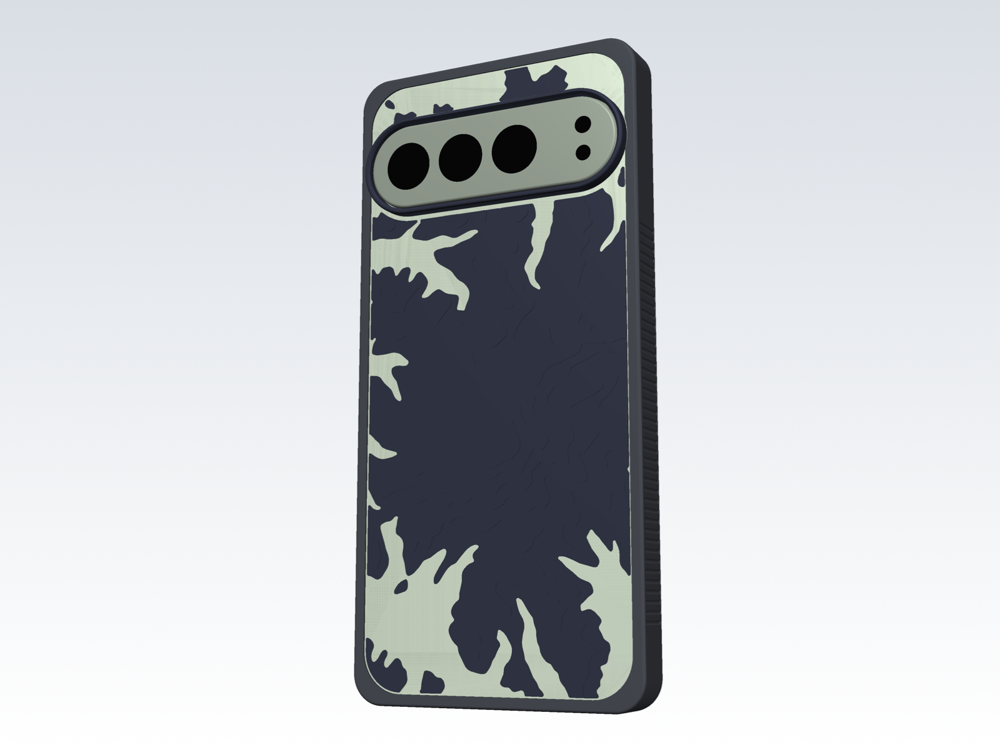
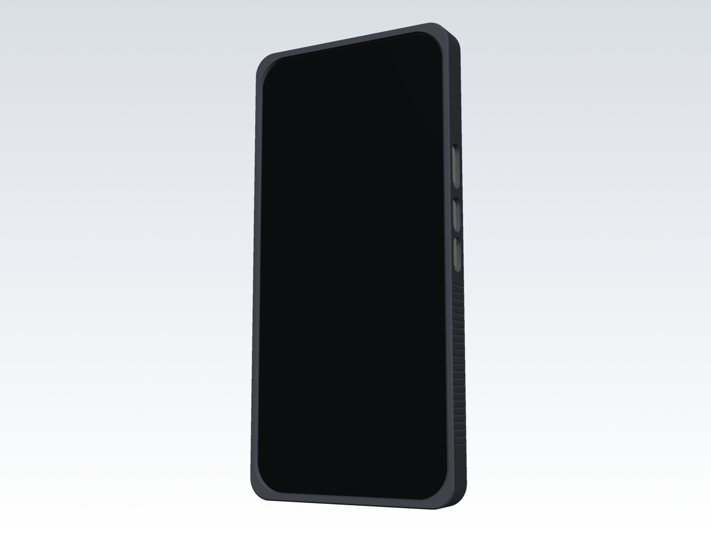
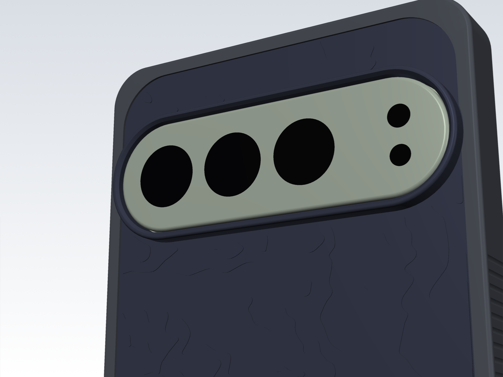
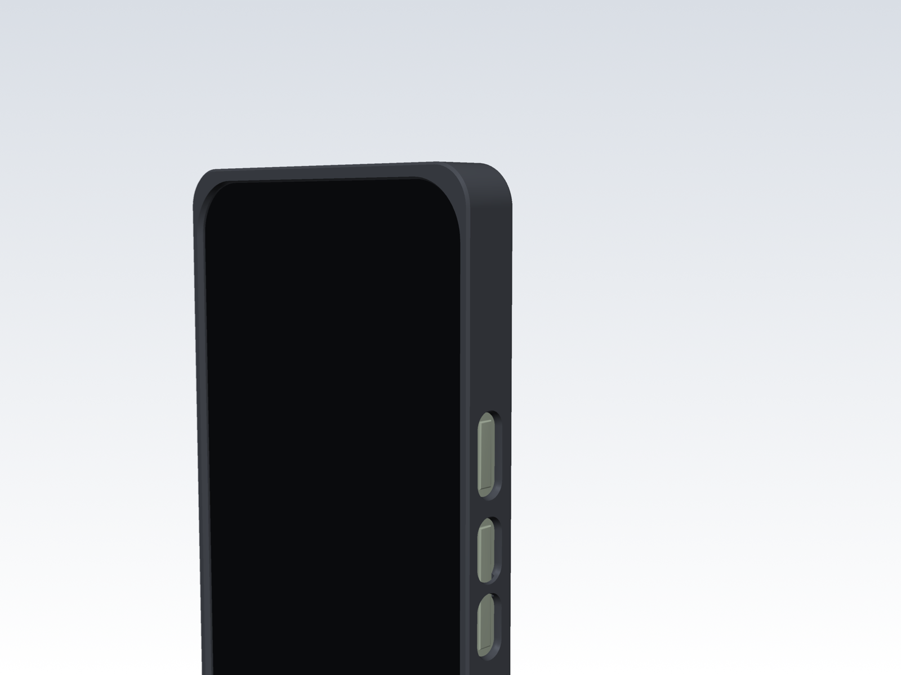

# Pixel 9 Pro XL case

A parametric, 3D-printable case for the Google Pixel 9 Pro XL, designed to
absorb drops (especially corner hits from a bike-mount fall) and to be cheap to
replace. It has two parts:

- **Bumper (TPU)**: side walls, front lip, thick corners with air pockets, and
  a rear rim that holds the plate in. It takes the hits and wears out first.
- **Back plate (PETG)**: covers the back glass, has the raised camera collar
  built in, and has a terraced topographic map of Mount Rainier on its face.
  Each terrace is one 0.15 mm print layer, so the layer lines are the contour
  lines.



| | |
|---|---|
|  |  |
|  |  |

## Why two parts

The camera bar stands 3.6 mm proud of the back glass. In a one-piece case
printed back-down, a raised collar around it would need support under the whole
back. The popular one-piece TPU cases avoid that with a flat back about 4 mm
thick, which makes the phone 14–15 mm thick and puts the wireless charger 4 mm
away. Printing the plate face-up instead lets the collar and the map grow
upward with no support. The back stays 1.25 mm thick (up to 2.15 mm at the map's
peaks), so Qi pads still work.

The plate isn't bonded to the TPU. The rim's 45° underside closes over the
plate's bevelled edge, and the phone presses the plate against it. TPU–PETG
adhesion doesn't matter here, and you can swap or reprint either part on its own.

## Protection

| Feature | Value | Why |
|---|---|---|
| Side wall | 1.4 mm TPU | two 0.7 mm perimeters from the 0.6 mm nozzle |
| Corners | 2.4 mm TPU plus a 1.3 mm air pocket | a corner hit compresses TPU into the pocket before it reaches the glass |
| Front lip | 1.4 mm above the screen, all round | face-down falls and slides land on the lip, not the glass |
| Long-side lips | 45° bevel, 0.5 mm high at the inner edge | edge-swipe gestures |
| Rear rim | 0.6 mm proud of the plate | protects the plate edge and the glass corners |
| Camera collar | 1.0 mm above the camera bar | the phone can lie on its back; the inner top edge is bevelled against flash glare |
| Fit | 0.10 mm side clearance, 0 in thickness | snug; TPU stretches and loosens a little with use |

The cross-sections in `out/renders/sections.png` show each of these against the
phone model.

## What to print

Everything is in `out/print/`. The `.3mf` files are PrusaSlicer projects with all
settings included. Open one, check the filament and sheet, and print.

| File | Material | Time | Filament | Notes |
|---|---|---|---|---|
| `test_fit_band_tpu.3mf` | TPU | 44 min | 7 g | Print first. The front 6 mm of the bumper: checks outline, corners, lip, buttons, ports |
| `test_camera_petg.3mf` | PETG | 19 min | 4 g | Top of the plate: checks the camera collar |
| `bumper_tpu.3mf` | TPU | 1 h 26 min | 13 g | |
| `plate_petg.3mf` | PETG | 1 h 11 min | 21 g | One colour, e.g. Galaxy Black |
| `plate_petg_2color.3mf` | PETG | 1 h 11 min | 21 g | Pauses (M600) at 1.40 mm: base layers in clear, map and collar in Galaxy Black. The clear lowlands show the Hazel phone through |

The times are PrusaSlicer 2.9.6 estimates for an Original Prusa MK3S+ with a 0.6
mm nozzle. Plain STLs are next to the projects, and the settings are also in
`out/profiles/*.ini` (File > Import > Import Config).

### Settings and tips

- **Printer**: Prusa's `MK3S & MK3S+ 0.6 nozzle` profile. Temperatures are raised
  for a hardened-steel nozzle: TPU 245 °C, PETG 250 °C.
- **TPU** (`Generic FLEX` preset, flow capped at 2 mm³/s): dry it first (about
  50 °C for 4–6 h). Loosen the extruder idler a little if it skips. If your TPU
  is softer than 95A, lower `filament_max_volumetric_speed` to 1.2.
- **PETG** (`Prusament PETG @0.6 nozzle` preset, 0.15 mm layers so every
  terrace is one layer).
- **Sheet**: TPU and PETG both stick hard to smooth PEI. Use glue stick as a
  release layer, or use a textured sheet. The bumper prints lip-down, and the
  plate prints inner-face-down, so the sheet sets the finish on the plate's
  inside face.
- **No supports** on either part.

## Assembly

1. Put the plate into the bumper from the **front**, collar first, so the collar
   pokes out through the rim at the back. The plate is a little larger than the
   lip opening: bow it slightly and stretch the TPU over one end, then the other.
2. Press the phone in the same way: bottom end first, then peel the lip over
   the top corners.
3. To take it off, push the phone out through the front from the camera
   window.

## Before the phone arrives: what's measured and what isn't

The phone model in `case/params.py` uses Google's published size, plus
positions measured from ten published Pixel 9 Pro XL cases. One of those cases
came with its author's caliper measurements, and one claims to be built from
Google's own CAD. Most values agree within 0.5 mm; each one in the file lists the
range found. **[MEASURE.md](MEASURE.md)** is a 15-item caliper checklist and
explains how to use the two test prints.

## Changing the design

All dimensions are named parameters in `case/params.py`: `Phone` for the phone,
`Case` for the case. After editing, rebuild everything:

```bash
uv sync                        # once
uv run python -m case.build    # about 40 s: geometry, STL/STEP, PrusaSlicer projects, slicing check, renders
```

Some useful knobs:

- `Case.fit`: side clearance. Raise it by 0.05 if the fit band is too tight.
- `Case.topo_source`: the map. Use a key of `case/topo.PLACES` (`rainier`,
  `half-dome`, `matterhorn`, `fuji`, `mt-washington`, `grand-canyon`), any
  `"lat,lon,width_km"`, `"procedural:<seed>"`, or `None` for a plain back.
  Elevation comes from the public AWS Terrain Tiles and is cached in `data/`.
- `Case.two_color_level`: which terrace the filament swap happens at in the
  two-colour plate.
- `Case.lip_h`, `lip_side`, `lip_end`: lip height and how far it reaches over
  the screen.
- `Case.outer_corner_r`, `corner_relief_r`: corner thickness and air pocket.
- `Case.grip`: flutes on the long sides.

The build checks that the bumper, plate and phone don't overlap. It slices
every project with PrusaSlicer and writes the times and masses to
`out/REPORT.md`. The CAD is in `out/cad/` as STEP: the whole assembly with the
phone, or each part on its own.

## Code map

| File | Contents |
|---|---|
| `case/params.py` | every dimension, with sources and ranges |
| `case/phone.py` | Pixel 9 Pro XL reference model |
| `case/bumper.py` | TPU bumper |
| `case/plate.py` | back plate, camera collar, relief |
| `case/topo.py` | elevation data and terrace generation |
| `case/slicer.py` | PrusaSlicer presets (flattened from Prusa's bundle) and projects |
| `case/build.py` | builds every output |
| `case/figures.py`, `render.py`, `sections.py` | renders and cross-sections (software OpenGL; no GPU) |
