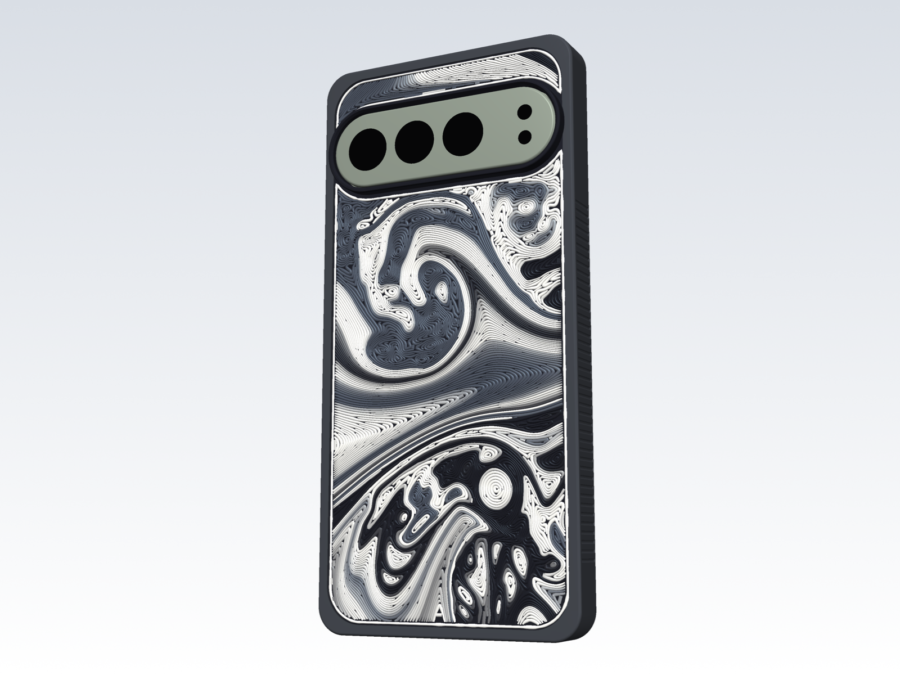
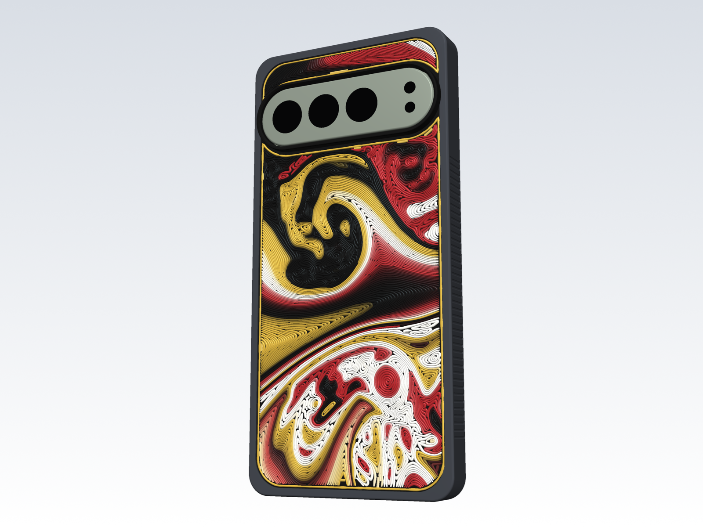
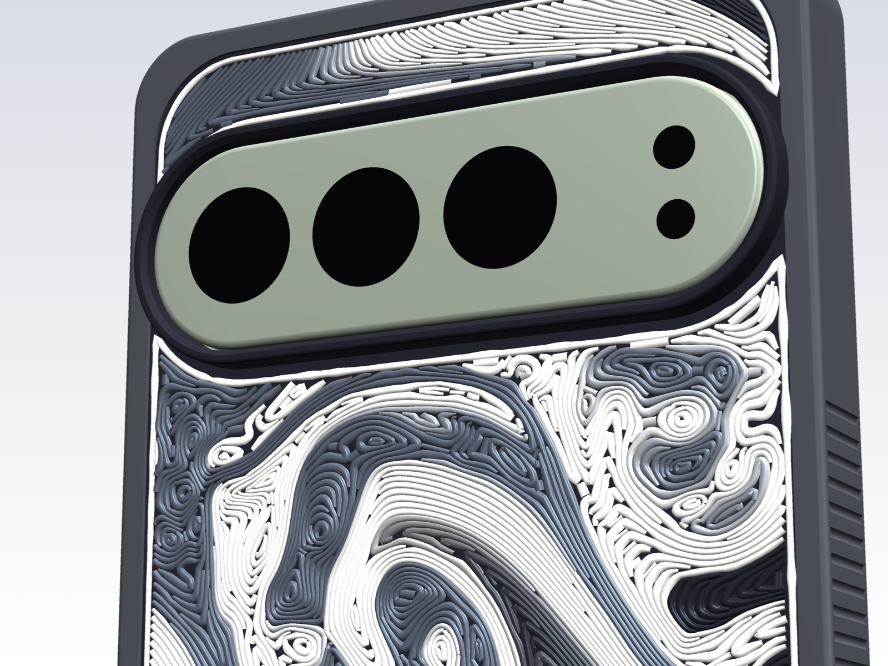
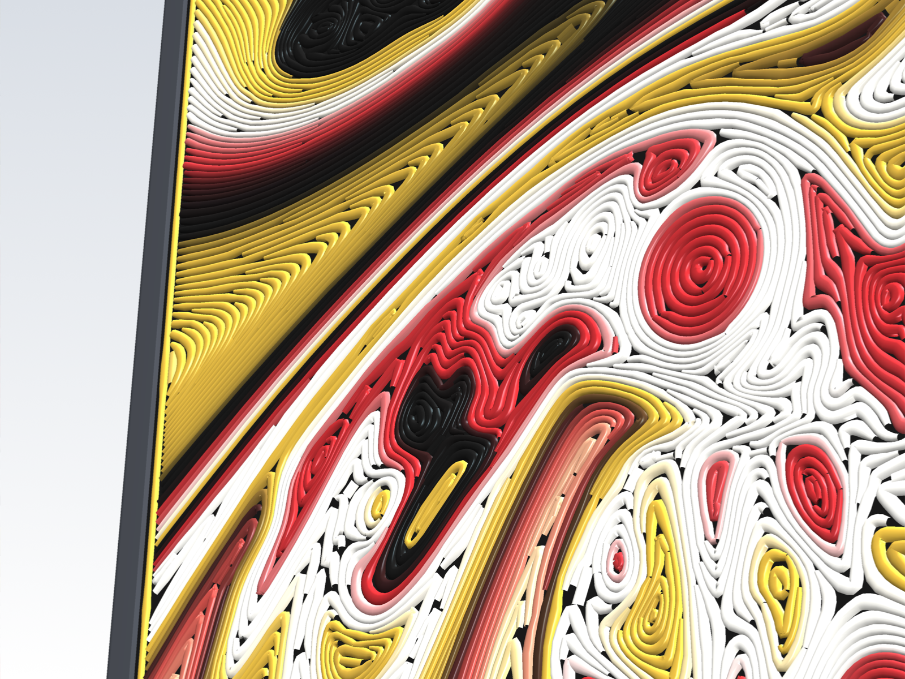

# Pixel 9 Pro XL case

A parametric, 3D-printable case for the Google Pixel 9 Pro XL, designed to
absorb drops (especially corner hits from a bike-mount fall) and to be cheap to
replace. It has two parts:

- **Bumper (TPU)**: side walls, front lip, thick corners with air pockets, and
  a rear rim that holds the plate in. It takes the hits and wears out first.
- **Back plate (PETG)**: covers the back glass and has the raised camera collar
  built in. Its visible face is one extra print layer whose lines follow dye
  streaks in a simulated turbulent wake behind the camera collar. Feed the
  extruder short pieces of different colours and the colours run along the
  streaks, like dye in a water tunnel.



| | |
|---|---|
|  |  |
|  |  |

## Why two parts

The camera bar stands 3.6 mm proud of the back glass. In a one-piece case
printed back-down, a raised collar around it would need support under the whole
back. The popular one-piece TPU cases avoid that with a flat back about 4 mm
thick, which makes the phone 14–15 mm thick and puts the wireless charger 4 mm
away. Printing the plate face-up instead lets the collar grow upward with no
support. The back is 1.5 mm thick (1.25 mm under the rim), so Qi pads still
work.

The plate isn't bonded to the TPU. The rim's 45° underside closes over the
plate's bevelled edge, and the phone presses the plate against it. TPU–PETG
adhesion doesn't matter here, and you can swap or reprint either part on its own.

## Protection

| Feature | Value | Why |
|---|---|---|
| Side wall | 1.4 mm TPU | two 0.7 mm perimeters from the 0.6 mm nozzle |
| Corners | 2.4 mm TPU plus a 1.3 mm air pocket | a corner hit compresses TPU into the pocket before it reaches the glass |
| Front lip | 1.4 mm above the screen, all round | face-down falls and slides land on the lip, not the glass |
| Long-side lips | 45° bevel, 0.5 mm high at the inner edge | edge-swipe gestures |
| Rear rim | 0.6 mm proud of the plate | protects the plate edge and the glass corners |
| Camera collar | 1.0 mm above the camera bar | the phone can lie on its back; the inner top edge is bevelled against flash glare |
| Fit | 0.10 mm side clearance, 0 in thickness | snug; TPU stretches and loosens a little with use |

The cross-sections in `out/renders/sections.png` show each of these against the
phone model.

## What to print

Everything is in `out/print/`. The `.3mf` files are PrusaSlicer projects with all
settings included. Open one, check the filament and sheet, and print.

| File | Material | Time | Filament | Notes |
|---|---|---|---|---|
| `test_fit_band_tpu.3mf` | TPU | 45 min | 7 g | Print first. The front 6 mm of the bumper: checks outline, corners, lip, buttons, ports |
| `test_camera_petg.3mf` | PETG | 18 min | 4 g | Top of the plate: checks the camera collar |
| `bumper_tpu.3mf` | TPU | 1 h 30 min | 13 g | |
| `plate_streamlines_petg.gcode` | PETG | 1 h | 21 g | The plate with the streamline layer. G-code, not a project: see below |
| `plate_streamlines_pla.gcode` | PLA | 1 h | 21 g | The same in PLA, for gold, red and clear pieces. PLA softens near 55 °C |
| `plate_petg.3mf` | PETG | 45 min | 18 g | The plate without the streamline layer: a plain flat back |

The times are PrusaSlicer 2.9.6 estimates for an Original Prusa MK3S+ with a 0.6
mm nozzle. Plain STLs are next to the projects, and the settings are also in
`out/profiles/*.ini` (File > Import > Import Config).

### Settings and tips

- **Printer**: Prusa's `MK3S & MK3S+ 0.6 nozzle` profile. Temperatures are raised
  for a hardened-steel nozzle: TPU 245 °C, PETG 250 °C.
- **TPU** (`Generic FLEX` preset, flow capped at 2 mm³/s): dry it first (about
  50 °C for 4–6 h). Loosen the extruder idler a little if it skips. If your TPU
  is softer than 95A, lower `filament_max_volumetric_speed` to 1.2.
- **TPU looks**: 0.15 mm layers smooth the 45° lip and the rim fillet for 2–3
  min more (TPU prints at its flow limit, so thinner layers barely slow it).
  Concentric lines on the lip and rim faces follow the outline instead of
  crossing the corners diagonally, and scarf seams hide the outer wall's seam
  where the contour is smooth. No ironing: TPU smears.
- **PETG** (`Prusament PETG @0.6 nozzle` preset): the hidden base prints in
  0.25 mm layers, the streamline layer is 0.25 mm, and the collar is 0.15 mm.
  The heights are layer-range modifiers in the project, so you can edit them in
  the GUI. No ironing: it would flatten the streamline beads.
- **Sheet**: TPU and PETG both stick hard to smooth PEI. Use glue stick as a
  release layer, or use a textured sheet. The bumper prints lip-down, and the
  plate prints inner-face-down, so the sheet sets the finish on the plate's
  inside face.
- **No supports** on either part.
- **Enclosure**: leave it open or vented. Neither material needs the heat, and
  a warm enclosure can cause heat creep with TPU on the MK3S.

## The streamline layer

**The flow.** A 2-D lattice-Boltzmann simulation (`case/lbm.py`, on the GPU with
numba-cuda, or on the CPU) of air coming down past the camera collar at a
Reynolds number of 30,000 on its 74 mm width, with 594 lattice cells across the
collar and a Smagorinsky subgrid model. The phone's back is a window into open
flow: the domain is five collar-widths wide, because walls at the phone's edges
would block 97% of the channel. The shear layers from the collar's ends roll up
into vortices that pair, merge and break into smaller eddies.

**Checking the flow for numerical noise.** At this Reynolds number the lattice
is almost inviscid, and it can grow grid-scale noise: striped wave packets about
five cells (0.6 mm) across, which the print would show as texture. Three
settings keep it out. The lattice inflow speed is 0.0125, so the fastest vortex
edges stay near 0.06; at 0.025 they reached 0.11 and the packets grew. The
Smagorinsky constant is 0.17. A separate bulk relaxation damps compression
waves (Dellar 2001). Each snapshot's vorticity and divergence spectra are
recorded at lattice resolution (`case/spectra.py`). The build refuses a snapshot
whose enstrophy piles up near the grid scale (the top band above 1% of the
middle band) or whose divergence variance exceeds 0.1% of its vorticity
variance. At Re 30,000, 15 of the 16 snapshots pass; the default is phase 8.
`out/renders/flow_spectra.png` shows the spectra and a map of the grid-scale
residual for the snapshot in use.

**Why dye, not streamlines.** An instantaneous streamline of a smooth 2-D field
looks like a field line from electrostatics. What reads as fluid in flow
photographs is dye: it records the flow's history, so it rolls up and folds into
filaments. The simulation carries a dye label (each parcel keeps the x at which
it entered), and the toolpaths are contours of that label, which are exactly the
streaklines of a rake across the inlet. Contours of one field never cross.

**The toolpaths** (`case/contourpaths.py`). The label, smoothed to 1.2 mm, is
contoured at thousands of fine levels, and each level is drawn only where the
local spacing calls for another line: level m is visible where the fine-level
density f = Δ / (|∇s| d) exceeds its threshold, which is level m's index
bit-reversed (an ordered dither). Lines run unbroken until they leave the window
or close on themselves; where the dye spreads, new lines start one by one at
scattered places instead of in a row, with hysteresis so they do not flicker on
and off. Each line is then nudged sideways toward the middle of its strip, beads
get the width of the strip they fill (0.47 to 1.0 mm), free ends taper, closed
loops start at a random point, one bead outlines the window, and a final pass
fills the larger holes. Lines print in order of dye label, each in the flow
direction, so colour fed in sequence becomes dye streams.

To print it:

1. Copy `plate_streamlines_petg.gcode` to the SD card and print it with black
   or Galaxy Black PETG loaded.
2. Before the colour change, turn the filament sensor off (Settings > Fil.
   sensor > Off). It would see each gap between pieces as a run-out.
3. About 38 min in, at 1.5 mm, the printer stops for a colour change (M600).
   Load piece 1, let it purge clean, and confirm.
4. Keep feeding: as the tail of each piece reaches the extruder's intake, push
   the next one in behind it, end to end. Cut the ends square.
5. At the second colour change, load black again for the collar, and turn the
   sensor back on.

The cut list, with the length and colour of each piece, and the layer's length
and time are in `out/REPORT.md`. The colours blend over 1–2 cm of filament in
the hotend, which the previews model (`out/renders/streamline_colors.png`). To
check the G-code before printing, open it in PrusaSlicer's G-code viewer:
`prusa-slicer --gcodeviewer out/print/plate_streamlines_petg.gcode`.

## Assembly

1. Put the plate into the bumper from the **front**, collar first, so the collar
   pokes out through the rim at the back. The plate is a little larger than the
   lip opening: bow it slightly and stretch the TPU over one end, then the other.
2. Press the phone in the same way: bottom end first, then peel the lip over
   the top corners.
3. To take it off, push the phone out through the front from the camera
   window.

## Before the phone arrives: what's measured and what isn't

The phone model in `case/params.py` uses Google's published size, plus
positions measured from ten published Pixel 9 Pro XL cases. One of those cases
came with its author's caliper measurements, and one claims to be built from
Google's own CAD. Most positions agree within about 1 mm, and the file lists the
range found next to each value. **[MEASURE.md](MEASURE.md)** is a 15-item caliper checklist and
explains how to use the two test prints.

## Changing the design

All dimensions are named parameters in `case/params.py`: `Phone` for the phone,
`Case` for the case. After editing, rebuild everything:

```bash
uv sync                        # once
uv run python -m case.build    # about 20 s: geometry, STL/STEP, PrusaSlicer projects, slicing, streamline G-code, renders
```

Some useful knobs:

- `Case.fit`: side clearance. Raise it by 0.05 if the fit band is too tight.
- `Case.design`: `"streamlines"` (the default), `"karman"` (a raised Kármán
  vortex street behind a small cylinder), `"topo"` (a terraced topographic
  map), or `"none"`.
- `Case.stream_phase`: which of 16 snapshots of the shedding cycle to use;
  `Case.stream_bands`: how many colour pieces; `Case.dye_smooth`: how fine the
  dye structure is; `Case.stream_source = "streamlines"` for instantaneous
  streamlines instead of dye. `lbm.Wake` sets the Reynolds number and the
  resolution. The snapshot in use is committed (`data/snap_*.npz`); any other
  takes about 9 min on the GPU (`uv sync --extra gpu`) to simulate.
- `Case.topo_source`: the map, for `design="topo"`. Use a key of
  `case/topo.PLACES` (`rainier`, `half-dome`, `matterhorn`, `fuji`,
  `mt-washington`, `grand-canyon`), any `"lat,lon,width_km"`, or
  `"procedural:<seed>"`. Elevation comes from the public AWS Terrain Tiles and
  is cached in `data/`.
- `Case.two_color_level`: which relief layer the filament swap happens at in
  the two-colour relief plates.
- `Case.lip_h`, `lip_side`, `lip_end`: lip height and how far it reaches over
  the screen.
- `Case.outer_corner_r`, `corner_relief_r`: corner thickness and air pocket.
- `Case.grip`: flutes on the long sides.

The build checks that the bumper, plate and phone don't overlap. It slices
every project with PrusaSlicer and writes the times and masses to
`out/REPORT.md`. The CAD is in `out/cad/` as STEP: the whole assembly with the
phone, or each part on its own.

## Code map

| File | Contents |
|---|---|
| `case/params.py` | every dimension, with sources and ranges |
| `case/phone.py` | Pixel 9 Pro XL reference model |
| `case/bumper.py` | TPU bumper |
| `case/plate.py` | back plate, camera collar, relief |
| `case/lbm.py`, `lbm_gpu.py`, `streamflow.py` | lattice-Boltzmann flow and dye past the collar (CPU and GPU) |
| `case/contourpaths.py` | dithered contours of the dye: the toolpaths |
| `case/streamtrace.py` | evenly spaced instantaneous streamlines (the `streamlines` source) |
| `case/toolpath.py`, `streamplate.py` | streamline layer: relaxation, bead widths, gap fill, G-code splice, colour mixing |
| `case/flow.py` | Kármán street behind a cylinder (the `karman` relief) |
| `case/topo.py` | elevation data and terrace generation |
| `case/slicer.py` | PrusaSlicer presets (flattened from Prusa's bundle) and projects |
| `case/build.py` | builds every output |
| `case/figures.py`, `render.py`, `sections.py` | renders and cross-sections (software OpenGL; no GPU) |
