# A phone case printed along a turbulent wake

A parametric, drop-first case for the Google Pixel 9 Pro XL, in two printed
parts: a bumper that takes the hits (TPU, or PETG for a stiffer shell), and a
PETG back plate. The plate's visible face is one layer of custom toolpaths. They trace dye through a
simulated turbulent wake: the wake of air flowing past the phone's own camera
bar. Short pieces of filament, fed into the printer one after another, become
streams of dye.

<p align="center">
  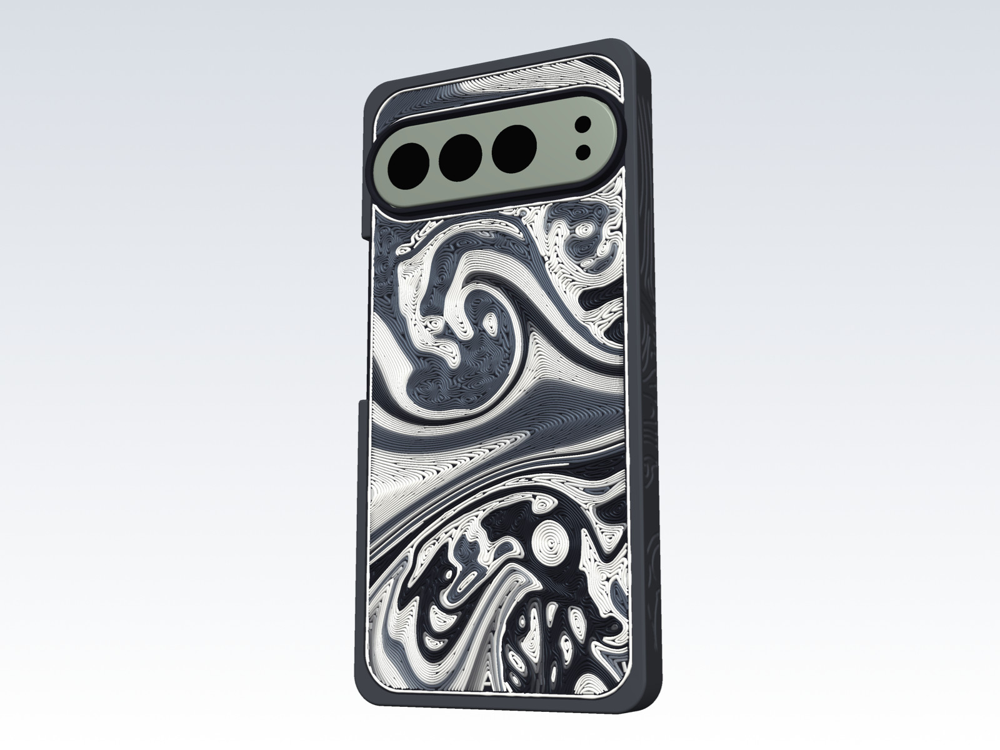
  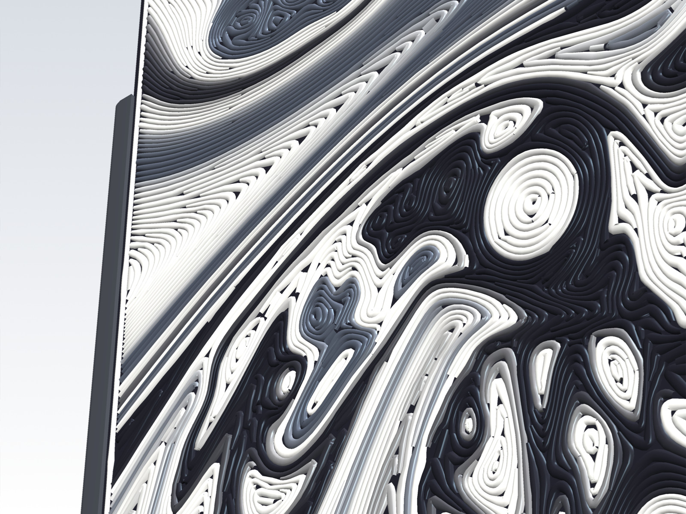
</p>

<p align="center">
  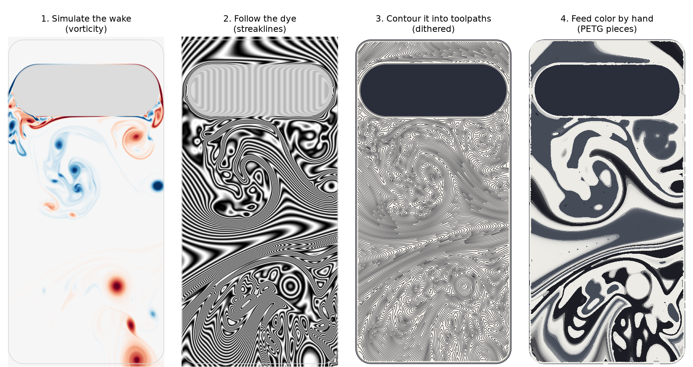
</p>

From simulation to plastic: a lattice-Boltzmann simulation at a Reynolds
number of 30,000 with the camera collar as the obstacle (1), a dye label carried
by the flow (2), contours of that label as toolpaths (3), and the colors of the
filament pieces as they will blend in the hotend (4).

> [!NOTE]
> **Status:** the phone has arrived and the first bumpers are printed, in TPU
> and in PETG. This version fixes what they showed (see [the first
> prints](#the-first-prints)); it and the back plate are not printed yet. The
> phone's dimensions come from Google's published size and from published cases.
> [MEASURE.md](MEASURE.md) lists what to check with calipers.

Everything is Python and rebuilds with one command:

- CAD in [build123d](https://github.com/gumyr/build123d), from named parameters in `case/params.py`
- a lattice-Boltzmann flow solver on the GPU (numba-cuda), with a CPU fallback
- toolpath generation and a G-code splice for the custom layer
- PrusaSlicer, driven from the command line, for everything else
- [PyVista](https://pyvista.org) renders with every printed bead modeled

## Gallery

<table>
  <tr>
    <td width="50%">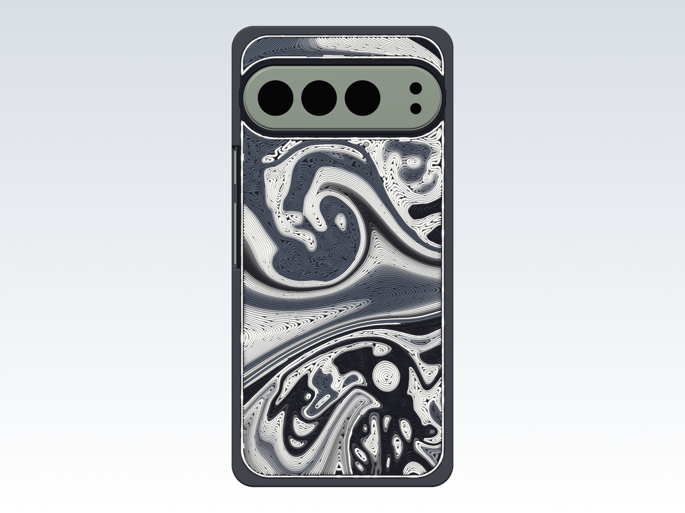</td>
    <td width="50%">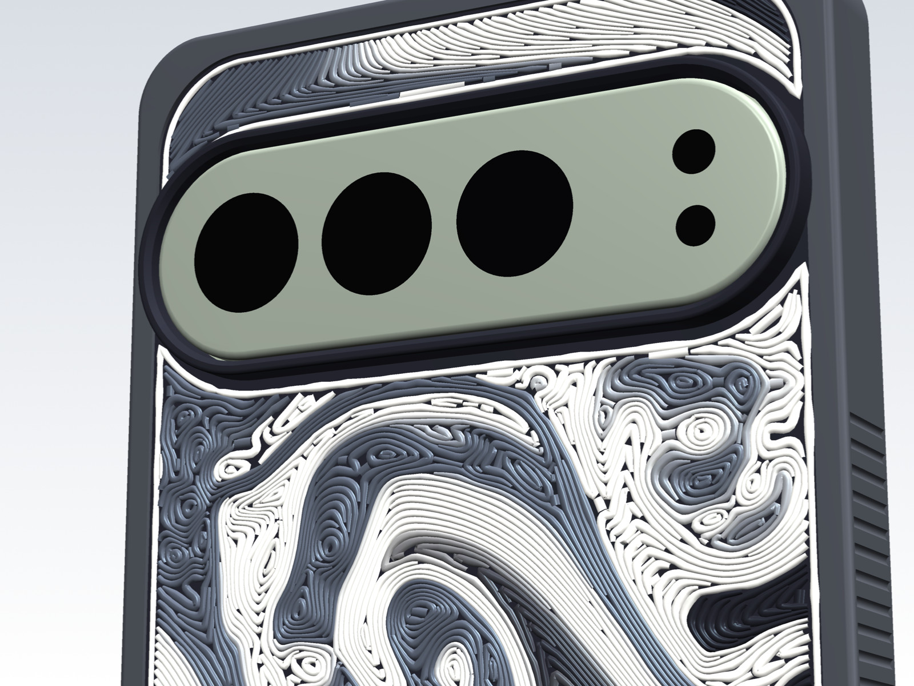</td>
  </tr>
  <tr>
    <td>Straight on. The flow comes in from the top and rolls up below the camera bar.</td>
    <td>Under the collar, in raking light: the shear layers break into small eddies.</td>
  </tr>
  <tr>
    <td>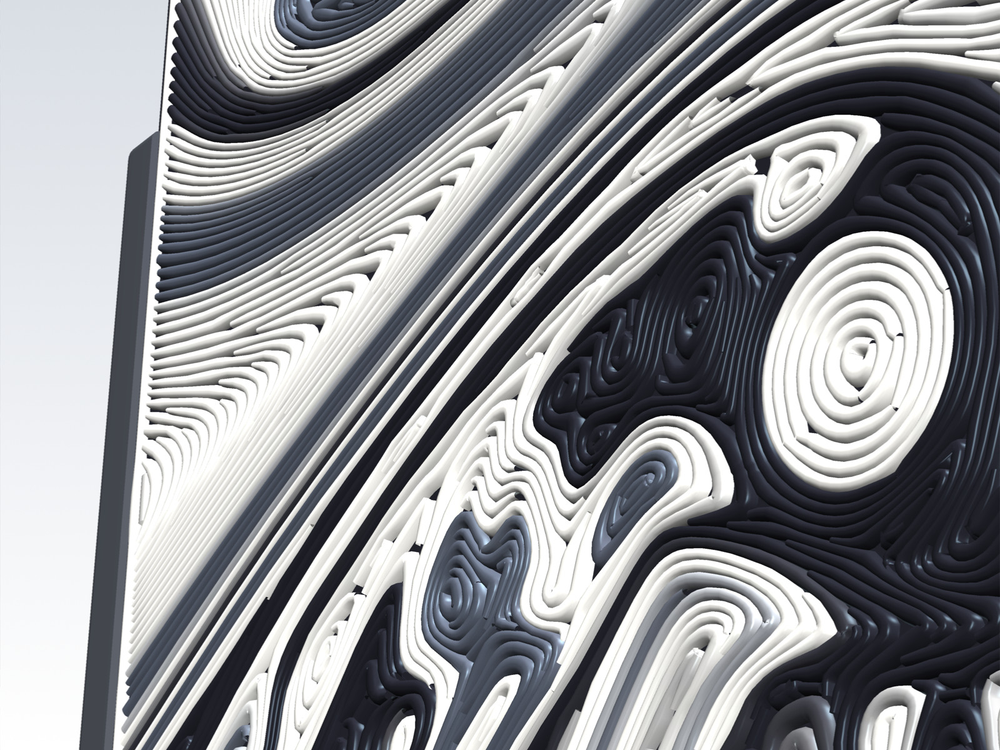</td>
    <td>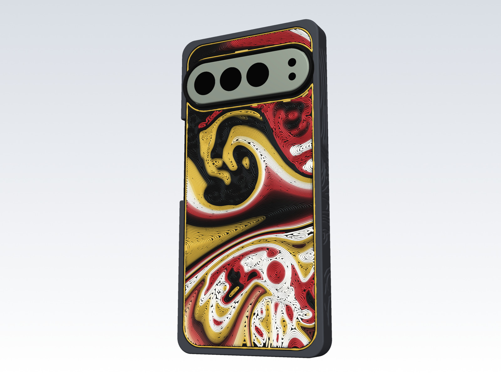</td>
  </tr>
  <tr>
    <td>Each bead is as wide as the strip it fills, from 0.47 to 1.0 mm.</td>
    <td>The same plate in PLA: gold, white, matte red and black. Brighter, but PLA softens near 55 °C.</td>
  </tr>
  <tr>
    <td>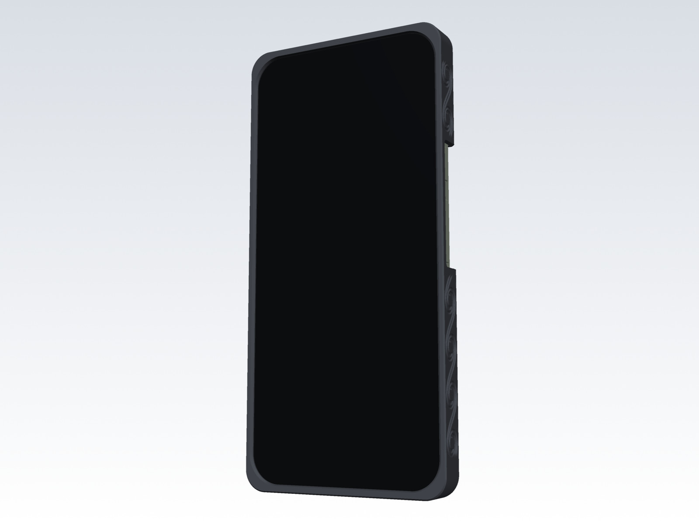</td>
    <td>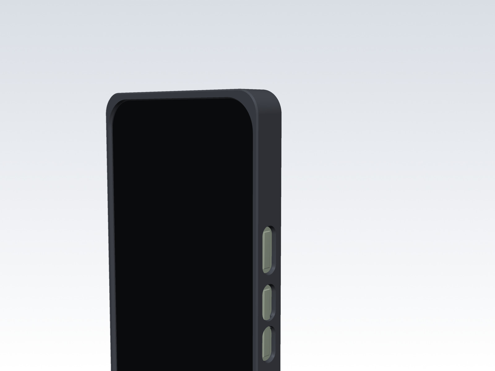</td>
  </tr>
  <tr>
    <td>The front: a 1.4 mm lip all round, beveled low on the long sides for edge gestures.</td>
    <td>Thick corners, where drops land, with an air pocket behind the wall. One open notch leaves both buttons free.</td>
  </tr>
  <tr>
    <td>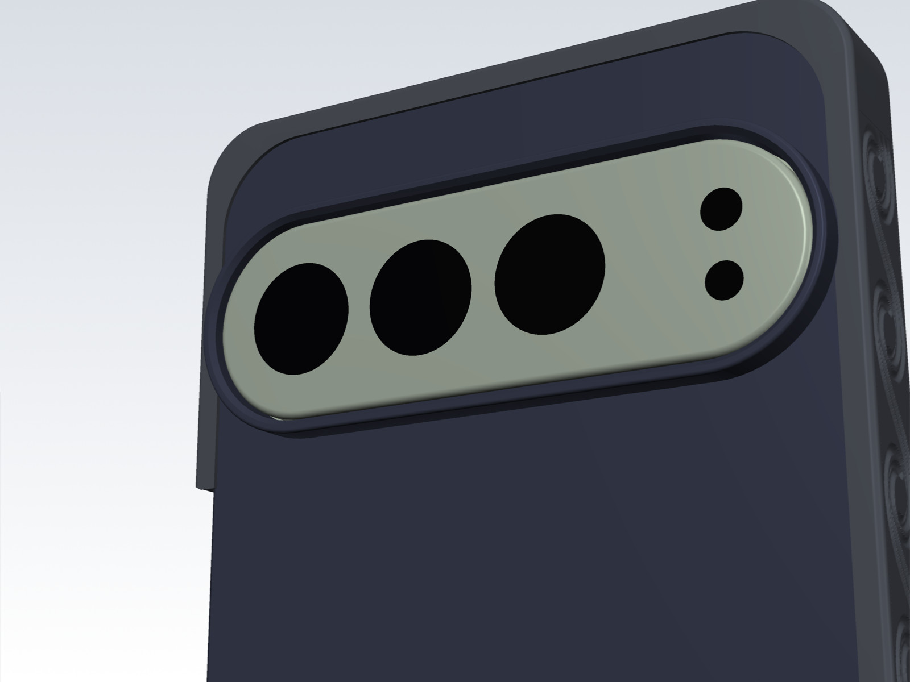</td>
    <td>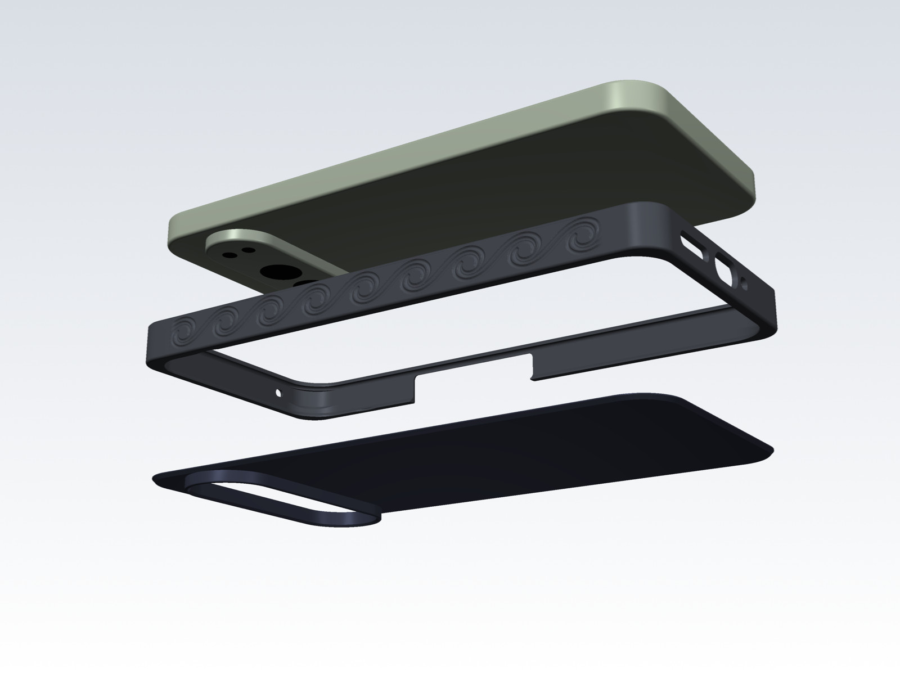</td>
  </tr>
  <tr>
    <td>The collar stands 1 mm above the camera bar, so the phone can lie on its back.</td>
    <td>Two parts. The bumper's rim holds the plate in, with no glue.</td>
  </tr>
</table>

## How it was made

### Measuring a phone that hadn't arrived

The design started before the phone was delivered. Google publishes the
outline (76.6 × 162.8 × 8.5 mm, with 12 mm corners) but not where the buttons,
ports and camera bar sit. Those positions come from Pixel 9 Pro XL cases
published on Printables: one includes its author's caliper measurements, and one says it
was built from Google's CAD. Most positions agree within about 1 mm, and
`case/params.py` records the range next to each value. The build checks that
phone, bumper and plate don't overlap, and draws cross-sections of the fit:

<p align="center">
  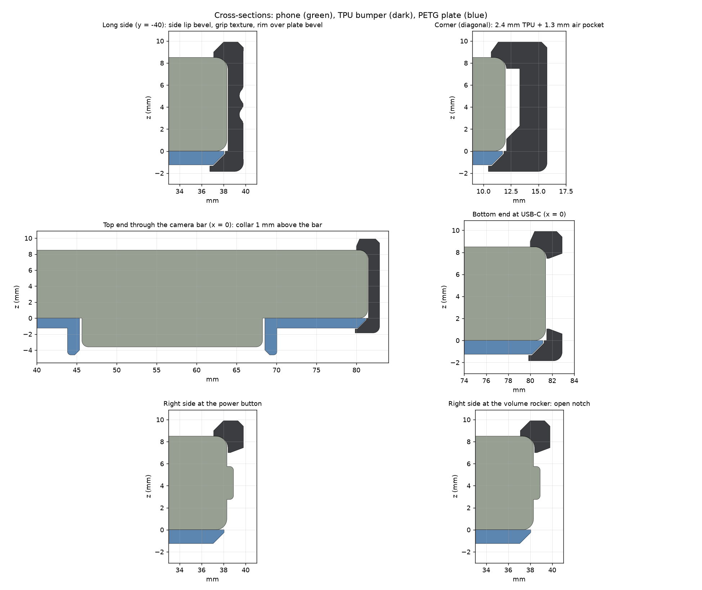
</p>

### Two parts, because of the camera bar

The camera bar stands 3.6 mm proud of the back glass. A one-piece case printed
back-down needs either support under a raised collar or a flat back about 4 mm
thick. That second option is the common one, and it makes the phone 14–15 mm
thick and moves a wireless charger 4 mm away. Two parts avoid both. The plate
prints face-up, so its collar grows straight up with no support, and it is
1.5 mm thick, so Qi charging still works. The plate isn't bonded to the TPU:
the bumper's rim closes over the plate's 45° beveled edge, and the phone holds
it there. Either part can be reprinted on its own.

| Feature | Value | Why |
|---|---|---|
| Side wall | 1.4 mm TPU or PETG | two 0.7 mm perimeters from a 0.6 mm nozzle |
| Corners | 2.4 mm TPU plus a 1.3 mm air pocket | a corner hit compresses TPU into the pocket before it reaches the glass |
| Front lip | 1.4 mm above the screen | face-down falls and slides land on the lip, not the glass |
| Long-side lips | 45° bevel, 0.5 mm high at the inner edge | room for edge-swipe gestures |
| Rear rim | 0.6 mm proud of the plate | protects the plate edge and the glass corners |
| Camera collar | 1.0 mm above the camera bar | the phone can lie on its back; the inner top edge is beveled against flash glare |
| Buttons | one notch over power and volume, open at the back | a closed window's back edge prints as a long, saggy bridge |
| Grip | the back's flow, continued over the edges: grooves along its streaklines, 0.35 mm deep | something to hold, from the same simulation as the back |
| Opening edges | rounded over into the wall, 0.8 mm radius | nothing sharp under a thumb, and a plug finds its port |
| Fit | 0.10 mm side clearance in TPU, 0.20 mm in PETG; none in thickness | TPU loosens a little with use; a rigid shell needs room to go on |

### The back, take 1: a topographic map

The first plate showed Mount Rainier as raised terraces, from the public AWS
Terrain Tiles, with a filament change partway up for a second color. Other
mountains, or procedural terrain, were one parameter away. At phone scale the
terraces were hard to read as a mountain.

<table>
  <tr>
    <td width="30%">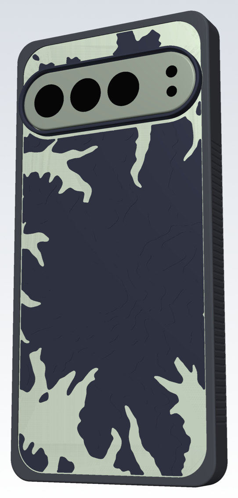</td>
    <td width="70%">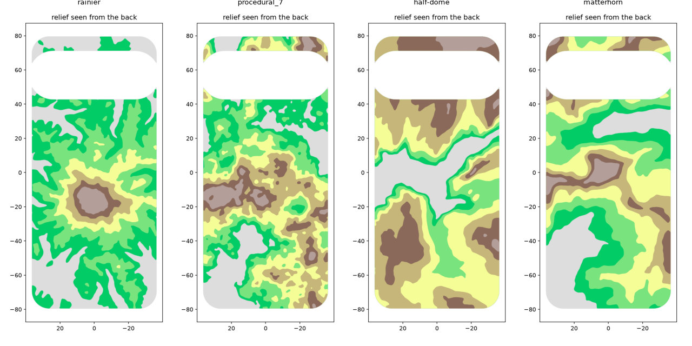</td>
  </tr>
</table>

### Take 2: a Kármán vortex street

Next came fluid dynamics: dye released from ports on a small cylinder, rolled up
into the alternating vortices of a Kármán street and printed as a raised relief
(left: the streaklines; right: the relief).

<p align="center">
  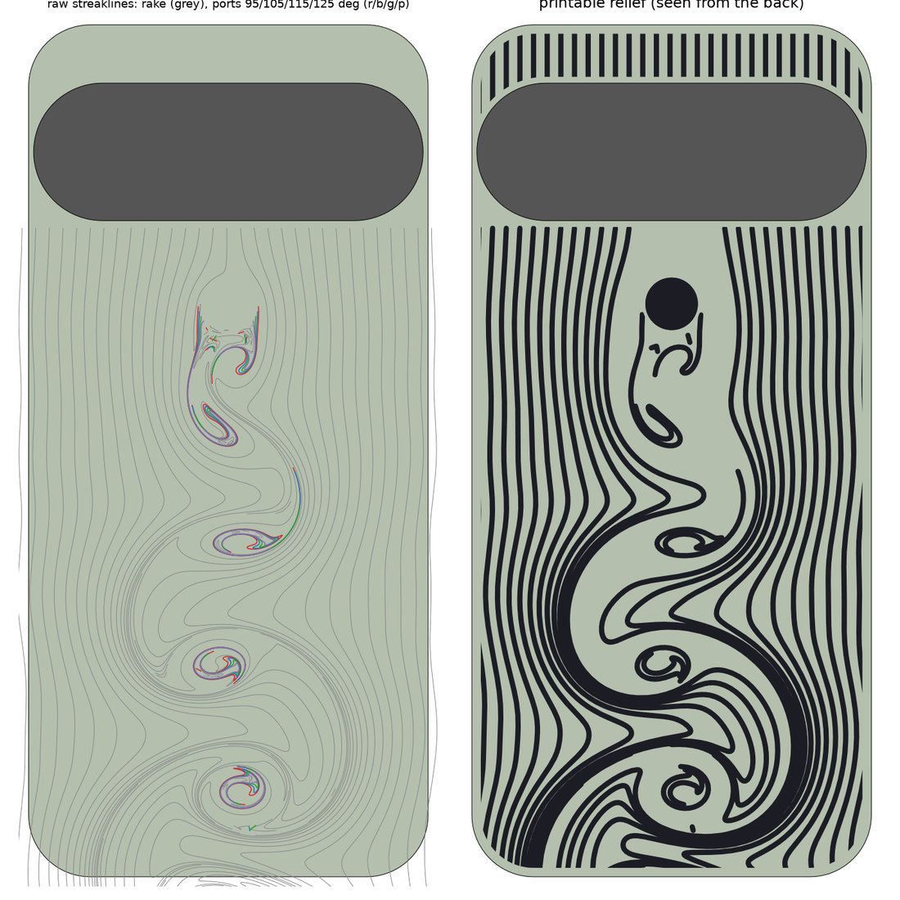
</p>

Two ideas replaced it. Make the camera collar itself the obstacle and simulate
the flow over the real phone back. And instead of printing a raised shape,
print the plate's last layer with its toolpaths running along the flow.

### Take 3: streamlines of the simulated wake

A lattice-Boltzmann solver (`case/lbm.py`) simulates air coming down the phone
and past the collar. The phone's back is a window into open flow: the domain is
five collar-widths wide with periodic sides, because walls at the phone's edges
would block 97% of the channel. At a Reynolds number of 1,000 the collar sheds
a clean vortex street. The first version traced evenly spaced streamlines of
one moment of it (the Jobard–Lefer method), with each bead as wide as its gap.

<p align="center">
  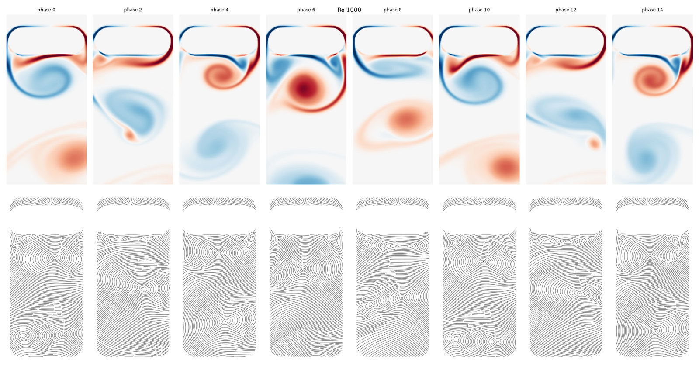
</p>

<table>
  <tr>
    <td width="30%">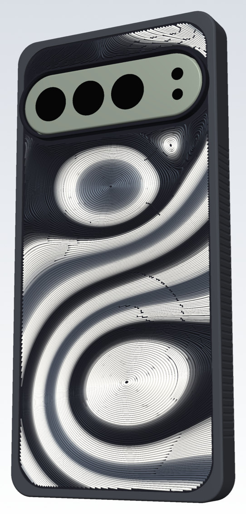</td>
    <td width="70%">It looked like electric field lines around charges.
    Instantaneous streamlines of a smooth 2-D flow always do: they show where
    the flow is going at one instant, not where it has been.</td>
  </tr>
</table>

### Take 4: dye

What looks like fluid in flow photographs is dye. Dye remembers where the flow
has been, so it rolls up into spirals and stretches into filaments. The solver
now carries a dye label: each parcel of fluid keeps the x position where it
entered. Contours of that label are the streaklines of a row of dye ports
across the inlet, and contours of one field never cross, so they make clean
toolpaths.

<p align="center">
  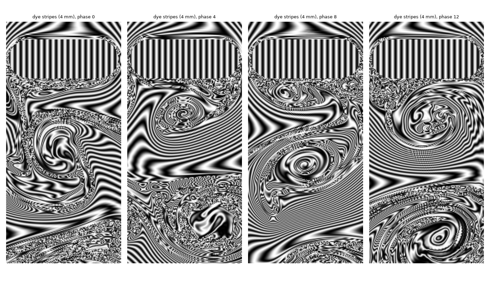
</p>

For turbulence, the Reynolds number went up to 30,000, with a Smagorinsky
subgrid model on 9.8 million lattice cells (0.125 mm, 594 cells across the
collar). That runs on the GPU through numba-cuda, at about 16 billion cell
updates per second. Below, an early sweep of Re 3,000, 10,000, 30,000 and
100,000, from before the stability fix described further down:

<p align="center">
  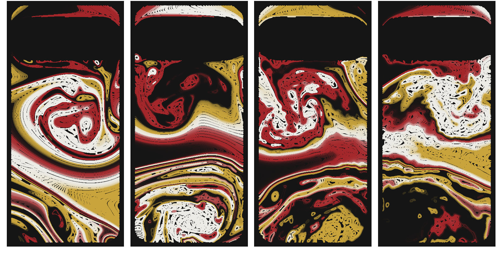
</p>

### From dye to toolpaths

**Where new lines start.** Where the flow spreads, contours pull apart and new
lines have to begin. If they all begin at once, they form a visible front. So
the label is contoured at thousands of fine levels, and each level is drawn
only where the local spacing calls for another line: level *m* appears where the
fine-level density *f* = Δ / (|∇*s*| *d*) exceeds *m* bit-reversed, a
one-dimensional ordered dither. New lines then start one at a time at scattered
places, with hysteresis so they don't flicker on and off. Lines run unbroken
until they leave the window or close on themselves, and closed loops start at
random points so their seams don't line up. Below, each line end is a red dot;
the right panel is an idea that was dropped: blending in the stream function
left zigzags.

<p align="center">
  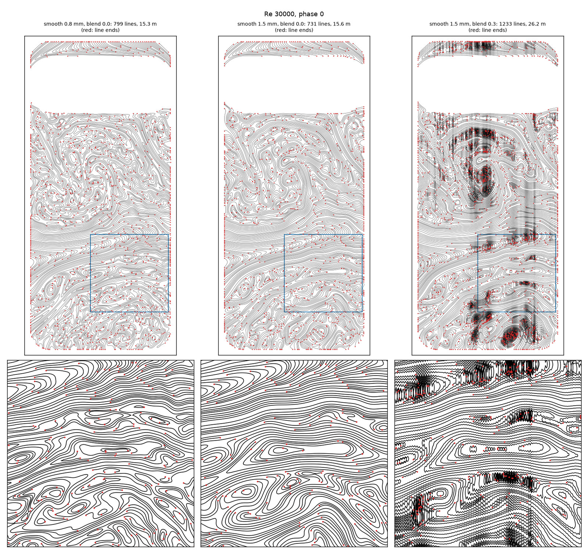
</p>

**Filling the plate.** Each line is nudged sideways toward the middle of its
strip. Beads get the width of the strip they fill, free ends taper, one bead
outlines the window, and a last pass fills any hole larger than 0.4 mm². That
took coverage from 92.6% to over 96%. Below, uncovered plate is red, before and
after:

<p align="center">
  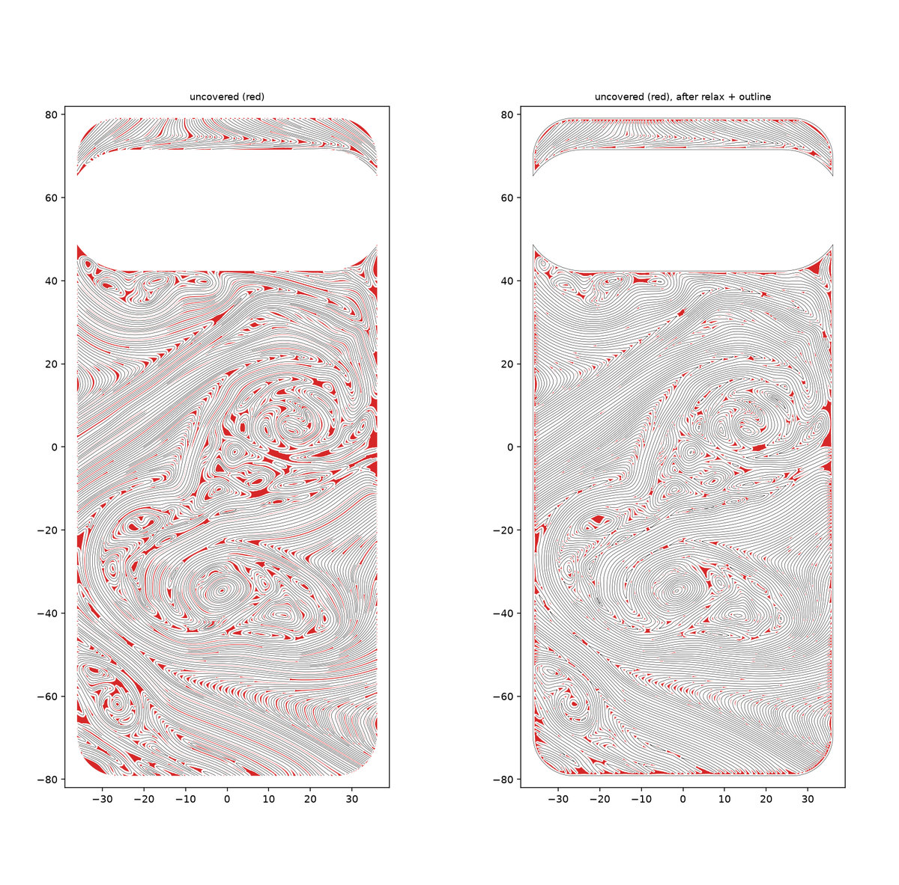
</p>

**Print order.** Lines print in order of dye label, each in the flow direction,
so colors fed in sequence come out as dye streams.

### Picking the moment

The solver saves 16 snapshots over one shedding period. Here are six of them at
Re 30,000. The plate uses phase 8: the shear layer under the collar winds into a
spiral and breaks into eddies toward the bottom.

<p align="center">
  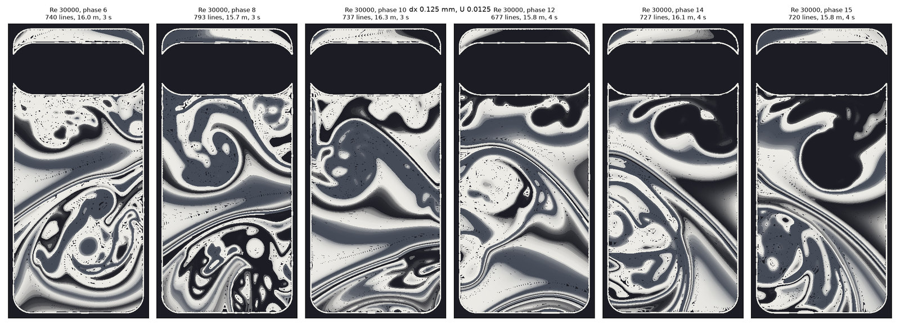
</p>

### A bug spotted by eye, confirmed by FFT

An earlier version of the plate used a flawed flow. Its vorticity had a
hatched texture near the strongest vortex core:

<p align="center">
  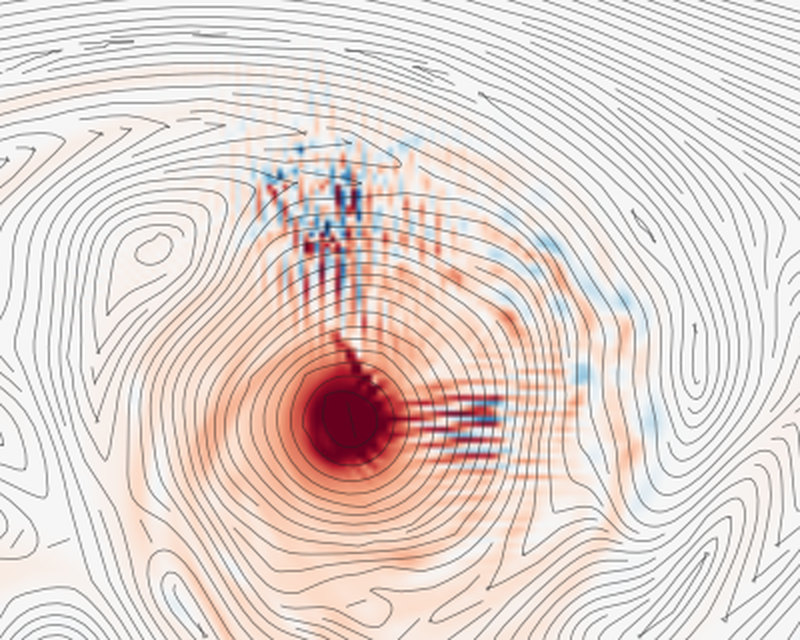
</p>

Spectra make that measurable. In a healthy 2-D flow, the enstrophy spectrum
(vorticity squared, by wavenumber) falls steeply toward the grid scale, and the
velocity field has almost no divergence. This one piled up enstrophy just below
the grid's Nyquist wavenumber, and its divergence peaked there:

<p align="center">
  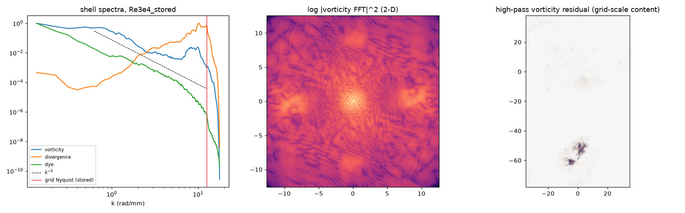
</p>

The noise formed compact wave packets about five lattice cells (0.6 mm)
across, lined up with the grid. Their spectra form spikes on the axes, here in
the wake far from any wall:

<p align="center">
  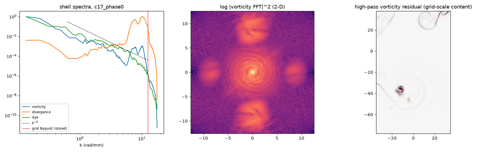
</p>

The evidence points to speed. Vortex edges reached 4.5 times the inflow speed,
a lattice velocity of 0.11. Regularized lattice-Boltzmann goes unstable at high
wavenumbers when the local speed is that high and the viscosity that low. Bulk
viscosity (Dellar, 2001) and a stronger subgrid model helped but did not cure
it. Halving the lattice speed did, at twice the number of steps. Each run below
is all 16 snapshots, checked at full lattice resolution:

| Reynolds number | Lattice speed | Smagorinsky constant | Bulk viscosity | Healthy snapshots |
|---|---|---|---|---|
| 30,000 | 0.025 | 0.10 | yes | 0 of 16 |
| 30,000 | 0.025 | 0.17 | yes | 0 of 16 |
| **30,000** | **0.0125** | **0.17** | **yes** | **15 of 16** |
| 10,000 | 0.025 | 0.10 | yes | 15 of 16 |
| 10,000 | 0.025 | 0.17 | yes | 13 of 16 |
| 10,000 | 0.0125 | 0.17 | yes | 16 of 16 |

The fixed flow takes 9 minutes on the GPU. Every run now records its spectra
at lattice resolution, and the build refuses a snapshot that fails: more than 1%
of the middle band's enstrophy in the top band, or divergence variance above
0.1% of the vorticity variance. It also plots the evidence for the snapshot in
use (`out/renders/flow_spectra.png`). The plate's snapshot passes with a top
band of 10⁻⁶ and divergence of 2 × 10⁻⁵:

<p align="center">
  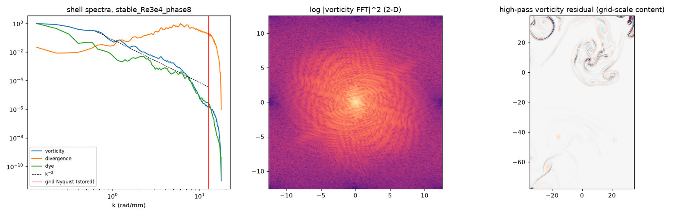
</p>

### Splicing it into the G-code

PrusaSlicer slices the plate with layer-range modifiers: a hidden base in
0.25 mm layers, a 0.25 mm layer at z = 1.5 mm, and the collar in 0.15 mm
layers above. The build replaces that one layer with the flow toolpaths, between
two color changes (M600). Each extrusion sets its own feed rate, travel moves
retract and lift, and the slicer's retraction state is restored at the end. A
checker reads the result back:

- 25,789 extrusions, all at 1800 mm/min and z = 1.5 mm, all inside the window
- no travel longer than 1 mm without a lift
- 793 lines, 15.7 m of path and 956 mm of filament, in about 16 minutes

<table>
  <tr>
    <td width="35%">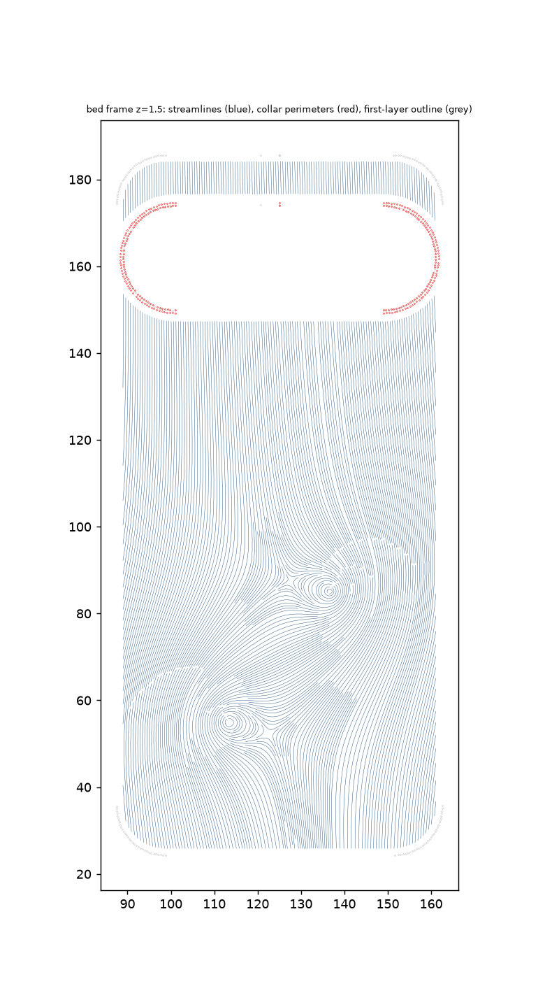</td>
    <td width="65%">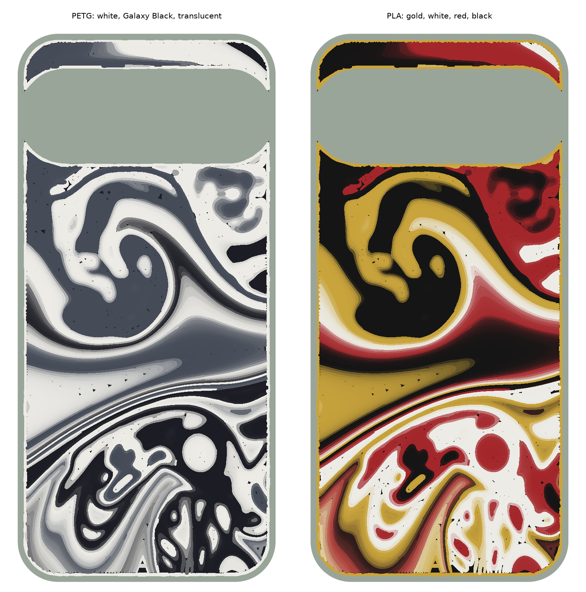</td>
  </tr>
  <tr>
    <td>Alignment check, from the first version: the spliced layer (blue) sits inside the slicer's perimeters (red).</td>
    <td>Predicted colors, with each change of filament blending over about 12 mm in the hotend.</td>
  </tr>
</table>

### The first prints

The first bumpers came off the printer once the phone arrived. In TPU the finish
was rough, mostly from damp filament. A PETG print of the same file went on, but
very tight. Both showed where the design fought the printer:

- **Bridges.** Printed lip-down, the back edge of each side window was a long
  bridge, and it sagged in both materials. One notch over both buttons, open at
  the back, has no bridge at all, and it lets a PETG shell flex as it goes on.
- **Hidden ceilings.** The corner air pockets ended in flat ceilings inside the
  wall, which printed as loose strands to trim with a knife. They now end in
  45° roofs, which print like any other wall.
- **Fit.** A rigid PETG shell gets 0.1 mm more room on each side than TPU.
- **Grip.** The straight grip flutes became the back's flow, carried over the
  edges. The simulation's domain is five collar-widths wide, so the flow just
  past the phone's long sides comes from the same solve as the back. Unroll the
  back over the rim and down a side wall, and each wall lands on a strip of that
  flow. The grooves follow the strip's dye streaklines, about 2.5 mm apart,
  thinned by the same dithering as the plate's lines. They are 0.35 mm deep,
  with a cosine profile that meets the wall without an edge, and they fade out
  at their ends. Unlike the old flutes, they also run above the buttons.
- **Edges.** The openings no longer end in square edges. Each one rounds over
  into the wall with a 0.8 mm radius, and so do the notch's open corners at the
  back.
- **Settings.** Both bumpers have tuned profiles: finer layers, cooler nozzles,
  shorter retraction, travel kept inside the walls, and seams away from the
  inside corners (see *Settings and tips* below).

<table>
  <tr>
    <td width="45%">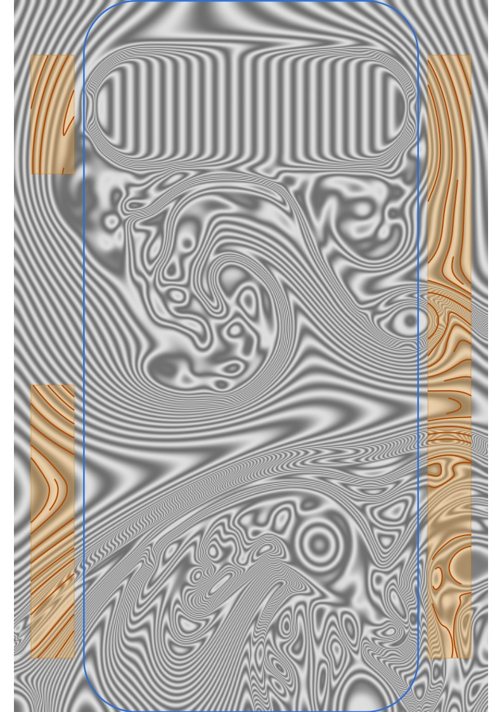</td>
    <td width="55%">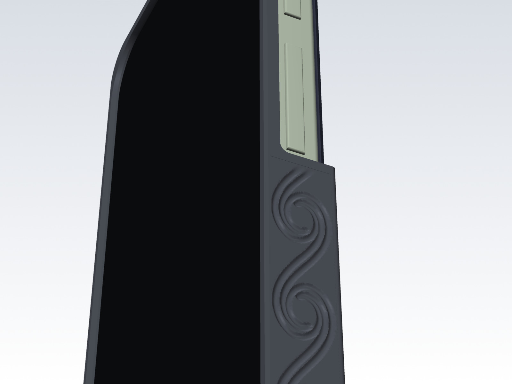</td>
  </tr>
  <tr>
    <td>The dye past the phone's edges, seen from the back. The orange strips fold onto the side walls; the lines are their grooves, with none over the buttons.</td>
    <td>The button side: the grooves and the open notch.</td>
  </tr>
</table>

## Print it

Everything is in `out/print/`. The `.3mf` files are PrusaSlicer projects with
all settings included. The times are PrusaSlicer 2.9.6 estimates for an
Original Prusa MK3S+ with a 0.6 mm nozzle.

| File | Material | Time | Filament | Notes |
|---|---|---|---|---|
| `bumper_tpu.3mf` | TPU | 1 h 40 min | 11 g | The bumper in TPU: softer, and it stretches over the phone |
| `bumper_petg.3mf` | PETG | 1 h 35 min | 12 g | The bumper in PETG: stiffer, 0.1 mm roomier on each side |
| `test_fit_band_tpu.3mf` | TPU | 50 min | 6 g | Optional: the front 6 mm of the bumper, to check outline, corners, lip and openings |
| `test_camera_petg.3mf` | PETG | 18 min | 4 g | Optional: the top of the plate, to check the camera collar |
| `plate_streamlines_petg.gcode` | PETG | 1 h | 21 g | The plate with the streamline layer (G-code, not a project; see below) |
| `plate_streamlines_pla.gcode` | PLA | 1 h | 21 g | The same in PLA for the brighter palette |
| `plate_petg.3mf` | PETG | 45 min | 18 g | A plain flat plate, without the streamline layer |

Plain STLs of the plate and the test pieces sit next to the projects. The
bumpers' textured meshes travel inside their `.3mf` files, and the build also
writes them as STL. The settings are also in `out/profiles/*.ini` (File >
Import > Import Config).

**The streamline layer**, with the filament sensor off:

1. Start `plate_streamlines_petg.gcode` with black or Galaxy Black PETG loaded.
2. Before the color change, turn the filament sensor off (Settings > Fil.
   sensor > Off). It would read each gap between pieces as a run-out.
3. About 38 min in, at 1.5 mm, the printer stops for a color change. Load the
   first piece, let it purge clean, and confirm.
4. Keep feeding: as the tail of each piece reaches the extruder, push the next
   one in behind it, end to end. Cut the ends square.
5. At the second color change, load black again for the collar, and turn the
   sensor back on.

The cut list, with the length and color of each piece, is in
[`out/REPORT.md`](out/REPORT.md). Add about 30 mm to the first piece for the
purge and 80 mm to the last so the extruder can still grip it. To check the
G-code first, open it in PrusaSlicer's G-code viewer.

<details>
<summary><b>Settings and tips</b></summary>

- **Printer**: Prusa's `MK3S & MK3S+ 0.6 nozzle` profile, with a 0.6 mm
  hardened-steel nozzle.
- **Bumpers**: 0.12 mm layers on a 0.15 mm first layer. That is finer than
  Prusa's 0.15 mm floor for this nozzle (lifted in the projects); much thinner
  than 0.1 mm, the wide nozzle face drags on the layer below. Outer walls print
  at 25 mm/s. Seams sit at the top end, away from the inside corners, with
  scarf joints where the contour is smooth. Travel stays inside the walls, so
  no strings cross the cavity or the openings. Overhangs slow down and get more
  fan the further they reach. Top and bottom lines are concentric. No ironing.
- **TPU bumper** (based on Prusa's `Ultrafuse TPU-95A` preset): 235 °C, flow
  capped at 1.8 mm³/s, 0.8 mm retraction at 25 mm/s and no z-hop, extrusion
  multiplier 1.05. Dry the filament first (about 50 °C for 4–6 h). If your TPU
  is softer than 95A, lower `filament_max_volumetric_speed` to 1.2.
- **PETG bumper** (`Prusament PETG @0.6 nozzle`): 240 °C, solid infill, 0.8 mm
  retraction with wipe, 0.2 mm z-hop, and up to 90% fan on overhangs.
- **PETG plate**: 250 °C for its faster 0.25 mm layers. The layer heights are
  layer-range modifiers in the project, so you can edit them in the GUI. No
  ironing: it would flatten the streamline beads.
- **Sheet**: TPU and PETG both stick hard to smooth PEI. Use glue stick as a
  release layer, or a textured sheet. The bumper prints lip-down, and the plate
  prints inner face down.
- **No supports** on either part. Leave an enclosure open or vented: neither
  material needs the heat, and a warm enclosure can cause heat creep with TPU.

</details>

**Which face is the front.** Without the plate, the bumper looks much the same
from both sides. The front is the face that printed on the bed: smooth, with a
narrow lip. The back has the rim and the pill-shaped window around the camera
bar. With the screen toward the front, the open notch sits over the buttons on
the right.

**Assembly.** Put the plate into the bumper from the front, collar first, so the
collar pokes out through the rim at the back: bow the plate slightly and stretch
the bumper over one end, then the other (a PETG bumper flexes most on the notch
side). Press the phone in the same way, bottom end first, then ease the lip over
the top corners. To take it off, push the phone out through the front from the
camera window.

## Build it

```bash
uv sync                        # Python 3.12 or 3.13
uv run python -m case.build    # about 30 s: geometry, STL/STEP, slicing, streamline G-code, renders
uv sync --extra gpu            # optional: an NVIDIA GPU, for new flow simulations
```

- `--no-slice` skips PrusaSlicer and the streamline layer, and `--no-render`
  skips the renders.
- The build finds PrusaSlicer on the PATH or as a Flatpak. If yours lives
  elsewhere, set `PRUSASLICER` to its command and `PRUSASLICER_PROFILES` to its
  `PrusaResearch.ini`.
- The flow snapshot in use is committed (`data/snap_*.npz`), so the build needs
  no GPU. A new Reynolds number or resolution takes about 9 minutes on an RTX
  5090, or many hours on a CPU.
- The build writes sizes, masses, print times, the spectral check and the cut
  list to `out/REPORT.md`, and STEP files of each part and of the whole assembly
  to `out/cad/`.

All dimensions are named parameters in `case/params.py`: `Phone` for the phone,
`Case` for the case. Some useful ones:

- `Case.fit`, `Case.fit_rigid`: side clearance for the TPU and the PETG bumper.
  Raise one by 0.05 if that bumper is too tight.
- `Case.btn_notch`: open button notch (default) or closed windows.
  `Case.grip_style`: `"flow"` (the back's flow over the edges) or the old
  `"flutes"`; `grip_sep` sets the groove spacing.
- `Case.design`: `"streamlines"` (the default), `"karman"`, `"topo"`, or `"none"`.
- `Case.stream_phase`, `stream_bands`, `dye_smooth`: which snapshot, how many
  color pieces, and how fine the dye structure is.
  `Case.stream_source = "streamlines"` brings back the field-line look.
- `lbm.Wake`: Reynolds number, resolution and lattice speed of the flow.
- `Case.topo_source`, for `design="topo"`: a key of `case/topo.PLACES`
  (`rainier`, `half-dome`, `matterhorn`, `fuji`, `mt-washington`,
  `grand-canyon`), any `"lat,lon,width_km"`, or `"procedural:<seed>"`.
- `Case.lip_h`, `lip_side`, `lip_end`, `outer_corner_r`, `corner_relief_r`,
  `grip`: lips, corners and grip flutes.

## Code map

| File | Contents |
|---|---|
| `case/params.py` | every dimension, with sources and ranges |
| `case/phone.py`, `bumper.py`, `plate.py` | the phone model, the bumper, the back plate and collar |
| `case/texture.py` | the grip texture: the back's flow carried over the edges, cut into the bumper's print mesh |
| `case/lbm.py`, `lbm_gpu.py`, `streamflow.py` | lattice-Boltzmann flow and dye past the collar (CPU and GPU) |
| `case/spectra.py` | the spectral health check |
| `case/contourpaths.py` | dithered contours of the dye: the toolpaths |
| `case/toolpath.py`, `streamplate.py` | relaxation, bead widths, gap fill, color mixing and the G-code splice |
| `case/streamtrace.py` | evenly spaced instantaneous streamlines (the `streamlines` source) |
| `case/flow.py`, `topo.py` | the Kármán and topographic designs |
| `case/slicer.py` | PrusaSlicer presets (flattened from Prusa's bundle) and projects |
| `case/build.py` | builds every output |
| `case/figures.py`, `render.py`, `sections.py` | renders and cross-sections (software OpenGL) |

## Credits

The phone geometry was cross-checked against these Pixel 9 Pro XL models on
Printables:
[984009](https://www.printables.com/model/984009),
[1036120](https://www.printables.com/model/1036120),
[1067953](https://www.printables.com/model/1067953),
[991572](https://www.printables.com/model/991572),
[1178004](https://www.printables.com/model/1178004),
[1019071](https://www.printables.com/model/1019071),
[983553](https://www.printables.com/model/983553),
[982903](https://www.printables.com/model/982903) and
[1446438](https://www.printables.com/model/1446438).
Elevation data for the topographic design comes from the
[AWS Terrain Tiles](https://registry.opendata.aws/terrain-tiles/), downloaded on
first use.

## License

[MIT](LICENSE).
